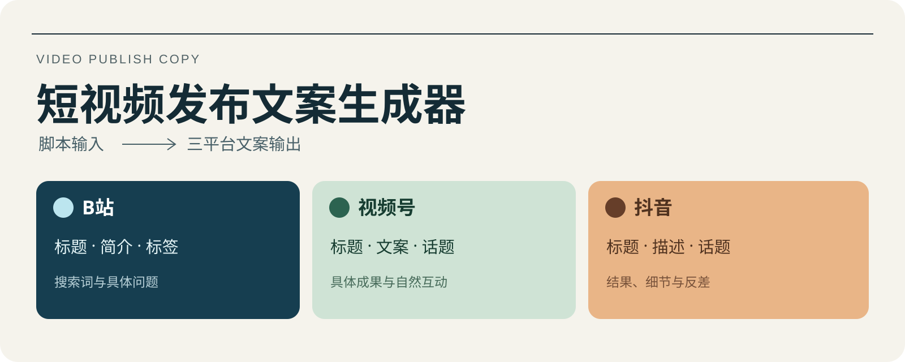

<p align="right"><b>简体中文</b> · <a href="README.en.md">English</a></p>

<p align="center"></p>

# 短视频发布文案生成器

把一段视频脚本、口播稿或内容简介，写成 **B站、视频号、抖音** 各自适合的发布文案。分别拟题，保留素材事实，生成后用本地脚本检查。

[快速开始](#快速开始) · [下载安装包](https://github.com/Jacobzhazha/video-publish-copy/releases/latest) · [完整案例](examples/README.md) · [多 Agent 安装](docs/installation.md) · [English](README.en.md)

## 一段材料，三种表达

| 平台 | 标题角度 | 交付内容 |
| --- | --- | --- |
| B站 | 具体对象、搜索词、问题 | 标题、结论在前的简介、8–10 个标签，可选置顶评论 |
| 视频号 | 成果、分享、自然互动 | 标题、简短文案、话题 |
| 抖音 | 结果、细节、反差 | 标题、描述、话题 |

也可以只生成一个或两个指定平台。输出统一保存在 `视频发布文案.md`。

## 快速开始

需要一个可用的 Agent；运行检查脚本需要 **Python 3.9+**，无需安装 Python 依赖。

```bash
git clone https://github.com/Jacobzhazha/video-publish-copy.git
cd video-publish-copy
python3 scripts/install.py --agent codex
```

这会把技能安装到个人目录 `~/.agents/skills/video-publish-copy/`。已有同名目录时停止，不覆盖。未显示时重新打开 Agent 会话。其他 Agent 把最后一个参数改成 `claude`、`cursor`、`gemini` 或 `copilot`；详见 [安装与调用](docs/installation.md)。

在 Codex 里发送：

> 使用 $video-publish-copy，根据下面的口播稿生成三平台发布文案，保存为视频发布文案.md。  
> 这份演示 CSV 有 6 条记录，按整行完全一致去重后剩 4 条。先保留原文件，用 Python 的 csv 模块读取，只把首次出现的整行写入新文件，顺序不变。同名但其他内容不同的记录不删。  
> 封面标题：表格去重前先留原件

Claude Code 使用 `/video-publish-copy`。Cursor 与 VS Code Copilot 可从 Agent 聊天的 `/` 菜单选择技能；Gemini CLI、Copilot CLI 的发现方式见安装页。

## 看一次完整输出

[CSV 案例输入](examples/01-csv-dedup/input.md) → [完整三平台文案](examples/01-csv-dedup/视频发布文案.md)

同一份“6 条演示记录去重后剩 4 条”的材料，在三个平台分别突出操作、判断和容易误删的细节。完整输出包含每个平台的正文与标签，不止标题列表。

<details>
<summary>展开查看输出结构</summary>

```markdown
# 视频名

## B站
### 标题
### 简介
### 标签
### 置顶评论

## 视频号
### 标题
### 文案
### 话题

## 抖音
### 标题
### 描述
### 话题
```

B站置顶评论可省略；其余小节按所选平台生成。

</details>

## 12 组完整案例

共 **12 组输入输出、30 份平台文案**，其中 11 组完整成稿、1 组保留待补项的草稿。每个目录均含原始 `input.md`、完整 `视频发布文案.md` 与机器可读的 `case.json`。

| 场景 | 平台 | 输入与完整输出 |
| --- | --- | --- |
| CSV 去重教程 | 三平台 | [查看](examples/01-csv-dedup/) |
| 文件批量命名 | 三平台 | [查看](examples/02-file-renaming/) |
| 技能 ZIP 检查 | 三平台 | [查看](examples/03-zip-inspection/) |
| 文案结构校验 | 三平台 | [查看](examples/04-caption-validation/) |
| 家常菜教程 | 三平台 | [查看](examples/05-tomato-eggs/) |
| 桌面整理 | 三平台 | [查看](examples/06-desk-reset/) |
| 分数知识讲解 | 三平台 | [查看](examples/07-fraction-addition/) |
| 阅读笔记方法 | 三平台 | [查看](examples/08-reading-notes/) |
| Mac 区域截图 | 仅视频号 | [查看](examples/09-macos-screenshot/) |
| 窗边人像知识 | 仅抖音 | [查看](examples/10-photo-exposure/) |
| JSON 格式化 | 仅 B站 | [查看](examples/11-json-formatting/) |
| 活动信息缺失 | 三平台草稿 | [查看](examples/12-event-draft/) |

## 输入与输出

输入可以是脚本、口播稿或内容简介，可附指定平台、封面标题与片内标题。素材中的数字、单位、日期、条件和成果会约束输出；不明确但非必要的信息可以省略，必要信息用 `【待补：具体缺什么】` 保留。

生成由宿主 Agent 完成，Python 脚本负责本地检查。没有 API Key 配置、独立生成服务或自动发帖流程。

## 本地检查

```bash
python3 scripts/check_publication.py /path/to/视频发布文案.md --require-complete

# 限定平台，并避免复用封面标题
python3 scripts/check_publication.py /path/to/视频发布文案.md \
  --platforms 视频号 抖音 --avoid-title '已有封面标题' --require-complete

# 验证仓库中全部案例与检查器
python3 scripts/validate_examples.py
python3 -m unittest discover -s tests -v
```

检查包括结构、必填项、顺序、标题重复、B站标题上限、标签数量、话题格式与网址。`--json` 提供结构化结果；退出码 `0` 通过、`1` 内容有问题、`2` 参数或文件错误。`--require-complete` 拦截仍含待补项的草稿。

## 项目结构

```text
SKILL.md                  技能入口
agents/openai.yaml        Codex 展示信息
references/               平台写法与完整参考
scripts/check_publication.py
scripts/install.py        只复制技能运行所需文件
scripts/validate_examples.py
examples/                 12 组完整输入输出
tests/                    检查器与安装器回归测试
docs/                     安装与使用说明
```

## 作者与许可

作者 [**Jacobzhazha**](https://github.com/Jacobzhazha)  
公众号：**渣渣的赛博宇宙**

[MIT License](LICENSE) · 欢迎提交 [问题](https://github.com/Jacobzhazha/video-publish-copy/issues) 或按 [贡献指南](CONTRIBUTING.md) 改进。
